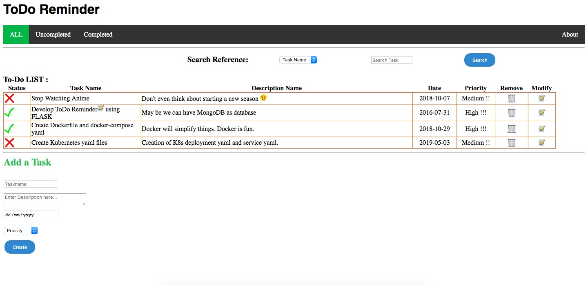

# ToDo Reminder (Flask + MongoDB)

A simple to-do list web app built with Flask and MongoDB, packaged with Docker and deployable to Kubernetes (local cluster or AWS EKS).



## Features

- Add, edit, delete, and search tasks (by name, description, date, priority, or ID)
- Mark tasks done / not done
- Filter views: all, uncompleted, completed
- Health endpoints for Kubernetes liveness and readiness probes

## Project structure

```
app.py               Flask application and routes
requirements.txt     Python dependencies
templates/           Jinja2 HTML templates
static/              CSS, JS, and images
Dockerfile           Image for the Flask app
docker-compose.yml   Flask app + MongoDB for local development
k8s/                 Kubernetes manifests for a local cluster (NodePort)
eks/                 Kubernetes manifests for AWS EKS (LoadBalancer, gp3 storage, probes)
```

## Configuration

| Variable     | Default     | Description            |
|--------------|-------------|------------------------|
| `MONGO_HOST` | `localhost` | MongoDB hostname       |
| `MONGO_PORT` | `27017`     | MongoDB port           |

Data is stored in the `camp2016` database, in the `todo` collection.

## Running locally

### With Docker Compose (recommended)

```bash
docker compose up --build
```

The app is at http://localhost:5000. MongoDB data is kept in the `mongo-data` volume.

### Without Docker

Requires Python 3.12+ and a MongoDB instance running on `localhost:27017`.

```bash
python -m venv .venv
source .venv/bin/activate
pip install -r requirements.txt
flask --app app run
```

## Deploying to Kubernetes

### Local cluster (e.g. minikube, kind)

```bash
kubectl apply -f k8s/mongo.yaml
kubectl apply -f k8s/flask.yaml
```

The app is exposed through the `flask-service` NodePort service. On minikube, run `minikube service flask-service` to open it.

### AWS EKS

The EKS manifests need the AWS EBS CSI driver installed on the cluster.

```bash
kubectl apply -f eks/storageclass.yaml
kubectl apply -f eks/mongo.yaml
kubectl apply -f eks/flask.yaml
```

`flask-service` is a `LoadBalancer`; get its external address with:

```bash
kubectl get service flask-service
```

The EKS deployment uses image `mjb9353/todo-app:v2`, rolling updates, and liveness/readiness probes.

## Building and pushing the image

```bash
docker build -t mjb9353/todo-app:v2 .
docker push mjb9353/todo-app:v2
```

## Health endpoints

| Route     | Purpose                                                                 |
|-----------|-------------------------------------------------------------------------|
| `/health` | Liveness: returns `200` while the app is healthy                         |
| `/ready`  | Readiness: returns `200` if MongoDB responds to a ping, `503` otherwise  |
| `/fail`   | Makes `/health` start returning `500`, to test the liveness probe        |
